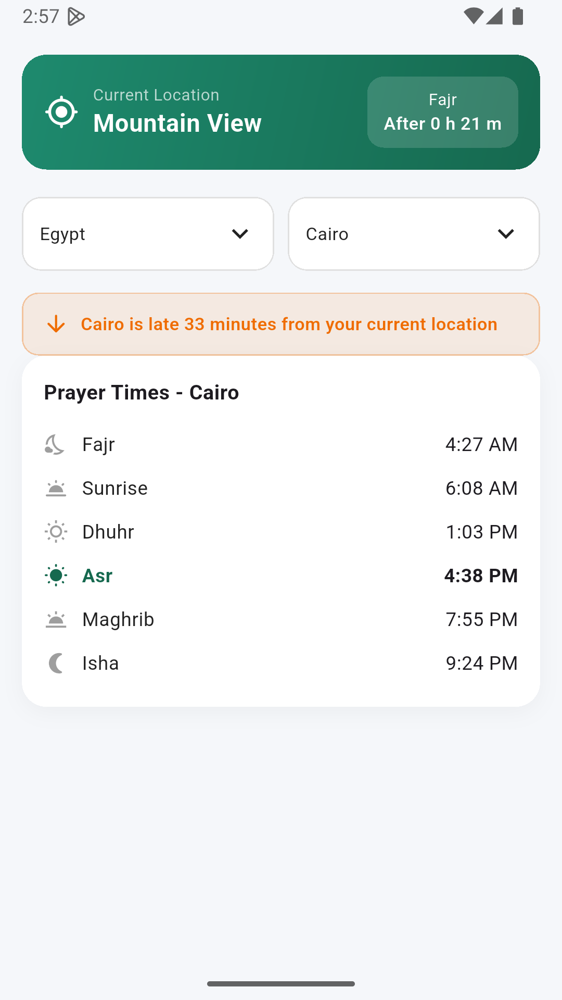
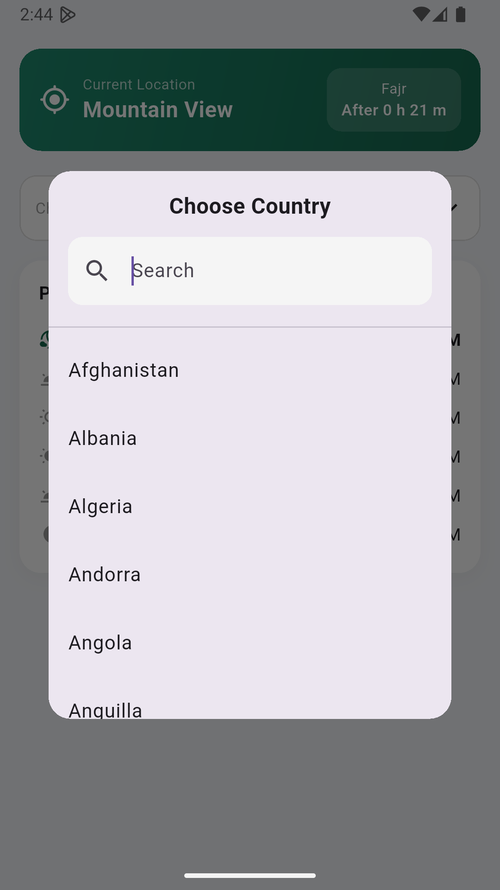
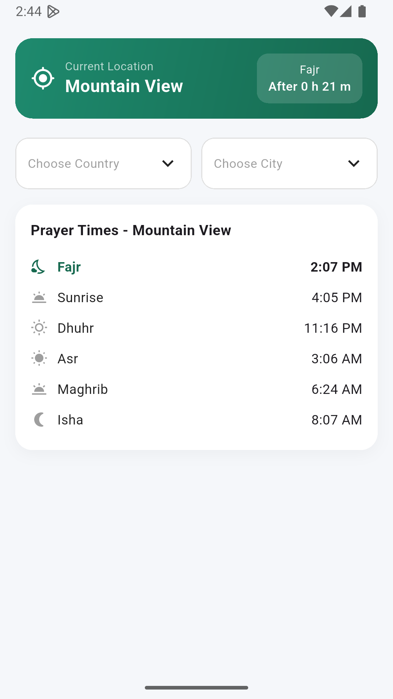

# Pray Sync - Prayer Times & Qibla

Pray Sync helps you stay connected with your daily prayers: accurate prayer times for your current location or any selected city, with Qibla direction.

## 📸 Screenshots

  
  
  

## ✨ Features

- Accurate prayer times for your current location or a selected city
- Countdown to the next prayer
- Qibla direction to help you find the direction of the Kaaba
- Support for multiple countries and cities, with search
- Alerts when your selected city's times differ from your current location
- Simple, easy-to-use interface
